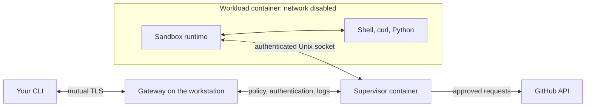
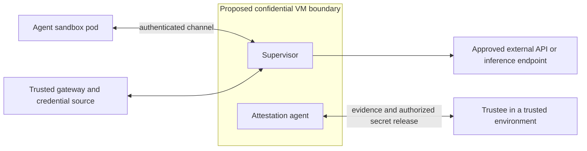

# learn-openshell

Run the actual OpenShell 0.1.7 gateway, supervisor, and sandbox locally with
rootless Podman. The workload is a shell with curl and Python, so no GPU, LLM,
API key, or Kubernetes cluster is needed. Explore how the supervisor enforces
filesystem and network policies around an untrusted workload.

The default Podman path exercises policy only. The optional Kata / CoCo path
runs the supervisor in a VM-backed Kubernetes pod. Neither path provides
hardware confidentiality or attestation.

## Choose a lab

| Path | What you run | Start here |
| --- | --- | --- |
| Podman | Gateway, supervisor, and agent as local rootless containers | [Podman path](#podman-path) |
| Kata / CoCo without a TEE | Disposable K3s VM with the supervisor in a Kata guest | [Kata / CoCo guide](docs/coco-nontee.md) |

For the Kata / CoCo path on a Linux x86_64 host with nested KVM:

```bash
./lab coco doctor
./lab coco up
./lab coco smoke
./lab coco openshell
./lab coco demo
```

The [Kata / CoCo guide](docs/coco-nontee.md) covers host requirements,
inspection, and cleanup. The rest of the run instructions below cover Podman.

## Podman path

Requirements: Linux x86_64, Podman 5.x with cgroups v2, a systemd user session,
curl, tar, sha256sum, and Python 3. OpenShell also requires Landlock and seccomp support;
this lab requests mandatory filesystem enforcement. The first setup needs
Internet access to GitHub, GHCR, Docker Hub, and Ubuntu package mirrors.
The network exercise contacts the unauthenticated GitHub `/zen` endpoint.
See NVIDIA's [support matrix](https://docs.nvidia.com/openshell/v0.1.7/about/support-matrix).

From this directory, initialize once:

```bash
./lab setup
```

This downloads checksum-pinned CLI and gateway binaries into `.local/`, creates
local TLS certificates, starts the Podman user socket, and builds the workload
image. Images and runtime volumes use your normal rootless Podman storage.
The `.containerignore` prevents the local keys and other workspace files from
entering the image build context. No system packages are installed.

In terminal 1, start the gateway and leave it running:

```bash
./lab gateway
```

In terminal 2:

```bash
./lab create
./lab demo
```

The first sandbox creation pulls the supervisor and sandbox runtime images.
The gateway listens at `https://127.0.0.1:17671` using mutual TLS. The wrapper
selects this lab's configuration and gateway for every CLI command.

The demo checks these outcomes:

| Exercise | Expected result | What it teaches |
| --- | --- | --- |
| Write `/sandbox/hello.txt` | Allowed | The workload has a writable workspace |
| Read `/opt/lab-private/example.txt` | Permission denied | Landlock restricts the workload's filesystem view |
| GET GitHub before a rule exists | Denied, with a policy log | Outbound access needs an explicit rule |
| Apply a read-only rule, retry GET | Successful response | Network policy can change while the workload runs |
| POST to the same `/zen` endpoint | `policy_denied` | The supervisor checks HTTP operations, not just hosts |

The fake secret is intentionally readable by UID 1000 in the image. Its denial
inside OpenShell should come from the filesystem policy. To compare with an
ordinary container using that same image:

```bash
podman run --rm --network none localhost/learn-openshell-tools:0.1.7 \
  cat /opt/lab-private/example.txt
```

The demo leaves the sandbox running so you can explore. It changes its policy;
to repeat from default deny, run `./lab delete`, then `./lab create`.

## Explore the Podman path

```bash
./lab inspect
./lab logs
./lab shell
```

Inside the sandbox, try `id`, `cat /sandbox/hello.txt`, and
`curl -sS https://api.github.com/zen`. Type `exit` to leave the interactive
session; the canonical workload is `sleep infinity`, so the sandbox remains
available.

You can use any CLI operation against the lab through the wrapper:

```bash
./lab cli status
./lab cli policy get learning --base
./lab cli sandbox exec learning -- cat /sandbox/hello.txt
```

The files controlling this example are [gateway.toml](gateway.toml),
[policy-deny.yaml](policy-deny.yaml), and [Containerfile](Containerfile).
The network exercise follows NVIDIA's
[policy tutorial](https://docs.nvidia.com/openshell/v0.1.7/tutorials/first-network-policy),
with a harmless POST target and explicit checks for policy-denial evidence.

## Podman topology



The gateway manages sandbox lifecycle and configuration. The supervisor is the
trusted policy decision point and opens approved upstream connections. The
sandbox runtime launches the workload and mediates its requests. In Podman,
the supervisor and workload are separate containers sharing the host kernel;
only the supervisor has host networking. This layout is described in NVIDIA's
[architecture](https://docs.nvidia.com/openshell/v0.1.7/about/architecture) and
[Podman configuration](https://docs.nvidia.com/openshell/v0.1.7/how-it-works/gateways/configuration).

No providers are attached in this lab. In a credential-enabled deployment,
the gateway/credential backend and supervisor belong to the trusted side;
the supervisor can inject approved credentials into outbound requests. Protecting
the supervisor alone does not automatically protect copies held by the gateway
or credential store. See the [provider model](https://docs.nvidia.com/openshell/v0.1.7/how-it-works/providers/overview).

## How Confidential Containers change the experiment

OpenShell limits what an untrusted agent can do. Confidential Containers add
a hardware-backed boundary intended to protect the chosen workload from the
infrastructure hosting it. One possible extension is to put the **supervisor**
inside a confidential VM-backed pod, with the agent sandbox outside that VM.



This is a proposed trust arrangement, not the non-TEE deployment supplied by
this lab. The secret delivery and gateway trust paths still need design and
validation.
The upstream [Confidential Containers architecture](https://confidentialcontainers.org/docs/architecture/)
describes the confidential VM, trusted execution environment (TEE), and
attestation components.

| Learning stage | What it establishes | What remains unproven |
| --- | --- | --- |
| Podman path | Real OpenShell components and policy behavior | VM isolation, attestation, Kubernetes integration |
| [Kata / CoCo non-TEE path](docs/coco-nontee.md) | Local K3s, Kata supervisor placement, and policy behavior | Hardware-backed confidentiality and attestation |
| CoCo on TDX or SEV-SNP | Hardware-backed isolation, when configured and attested correctly | Protection of secrets outside the measured boundary |

Upstream supports [CoCo development without confidential hardware](https://confidentialcontainers.org/docs/getting-started/prerequisites/hardware/nontee/).
The `non-tee` deployment does not provide CoCo's confidentiality guarantees.
A mocked or sample attestation result is not evidence of hardware protection.

See [Confidential Containers exploration notes](docs/confidential-containers.md)
for questions to investigate when extending this lab.

## Stop and clean up the Podman path

While the gateway is still running:

```bash
./lab delete
```

Then press Ctrl-C in the gateway terminal. This keeps the binaries, certificates,
database, and cached images for next time. Start again with `./lab gateway`
and `./lab create`. Do not delete `.local/` while the gateway or its sandboxes
are running. The Podman user socket remains available for other applications.

## Troubleshooting the Podman path

- **Gateway unavailable:** keep terminal 1 running; check that port 17671 is free.
  Initial registration during setup warns that the gateway is not reachable;
  that is expected before the first startup.
- **Podman socket missing:** run `systemctl --user start podman.socket` as your
  normal user. Run the whole lab without `sudo` so it uses the same image store.
- **Image pull failure:** check access to GHCR and Docker Hub. A registry or TLS
  error is not evidence that an OpenShell policy denied a request.
- **Kernel qualification or Landlock failure:** use a compatible host kernel.
  Do not relax the mandatory policy to make the test appear successful.
- **Proxy or private CA required:** configure the gateway's Podman driver using
  NVIDIA's configuration reference. Do not disable TLS verification.
- **Demo already allowed:** the previous run added a rule; delete and recreate
  the lab sandbox before rerunning.

OpenShell binaries and runtime image tags are pinned to 0.1.7. Ubuntu packages
follow the 24.04 repositories, so the tools image is not a bit-for-bit reproducible
build. The observed validation results are in [VALIDATION.md](VALIDATION.md).
