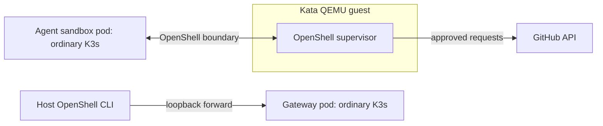

# Kata / CoCo non-TEE lab

This optional path runs OpenShell 0.1.7 on a disposable Ubuntu 24.04 VM with
K3s. The OpenShell **shared supervisor** Deployment uses the
`kata-qemu-coco-dev` RuntimeClass; the gateway and agent sandbox use the
ordinary K3s runtime. Kata starts a separate QEMU guest for the supervisor
inside the K3s VM.

**`kata-qemu-coco-dev` has no TEE. It provides no hardware-backed
confidentiality, attestation, or protected secret release.** The lab has no
Trustee and uses no real provider credentials. It is for learning pod
placement, guest VM behavior, Kubernetes networking, and OpenShell policy.



## Requirements and run sequence

Use a Linux x86_64 host with accessible `/dev/kvm` and nested virtualization,
QEMU, `qemu-img`, `genisoimage`, OpenSSH client tools, curl, Python 3, and
rootless Podman. Allow at least 4 CPUs, 8 GiB RAM, and 40 GiB disk for the VM,
plus room for downloaded images. QEMU uses user-mode networking and binds
host ports **22222** (SSH) and **17672** (gateway) to loopback only.
Setup downloads the Ubuntu cloud image, K3s, Helm, CoCo, Agent Sandbox,
OpenShell, and container images from public upstreams. The Ubuntu cloud image
and Helm and OpenShell CLI archives are checksum checked. Charts and image
tags are version pinned but not digest pinned.

```bash
./lab coco doctor
./lab coco up
./lab coco smoke
./lab coco openshell
./lab coco demo
```

`up` boots the VM, installs K3s v1.35.9+k3s1 and Helm v3.19.0, then installs
the CoCo chart v0.23.0 with only its development shim enabled. `smoke` starts
a `kata-qemu-coco-dev` BusyBox pod and checks for a QEMU process. It also
checks K3s NetworkPolicy enforcement: an HTTP request succeeds before a deny
policy and fails afterward. Its test namespace is removed when the command
finishes. If either check fails, fix the environment before installing
OpenShell; the OpenShell deployment needs enforced NetworkPolicy.

`openshell` installs Agent Sandbox v1.0.3 and the OpenShell Helm chart v0.1.7.
A strict Helm post-renderer changes exactly one Deployment labeled as the
OpenShell supervisor and fails on a missing or ambiguous match. The lab checks
the supervisor pod's RuntimeClass and a running QEMU process. It builds the
same tools image as the Podman lab and imports it into K3s containerd. The
host CLI and TLS bundle live under `.local/coco/`. The gateway accepts
unauthenticated user calls inside this disposable VM and is available to the
host through the loopback forward. **Do not reuse these chart values on a
shared cluster.**

`demo` creates a `coco-learning` sandbox with no provider and the same
default-deny policy as the Podman path. It checks fake-secret denial, denied
GitHub GET with log evidence, a live policy update allowing GET, reconnection
after a supervisor rollout, and continued POST denial. It leaves the sandbox
running for inspection. The agent pod
should show the default runtime; the supervisor should show
`kata-qemu-coco-dev`.

```bash
./lab coco inspect
./lab coco logs
./lab coco shell
./lab coco cli policy get coco-learning --base
```

To repeat the exercise, run `./lab coco delete`, then `./lab coco demo`. Run
`./lab coco down` to stop the VM while keeping its disk and keys; `up`
restarts it. `./lab coco destroy` stops the VM and removes only `.local/coco/`.
The rootless Podman image cache is left alone.

The placement checks establish a Kata development VM for the supervisor and
exercise OpenShell behavior across the pod boundary. They do **not** show that
a host administrator cannot inspect memory or that secrets are released only
after hardware attestation. The gateway database, TLS keys, Kubernetes
Secrets, and local VM files lie outside the Kata guest. Moving the supervisor
cannot protect copies held elsewhere. This lab targets the **shared**
supervisor topology. OpenShell's dedicated per-sandbox supervisor path has a
separate pod builder and is not changed by this post-renderer. Recheck
placement, connectivity, policy, and restart behavior after changing the
OpenShell version or topology.

If the VM fails to boot, inspect `.local/coco/serial.log`. For guest access,
SSH to `127.0.0.1:22222` as `ubuntu` with `.local/coco/id_ed25519`. For a
gateway failure, inspect `learn-openshell-forward.service` and the gateway
pod in the guest. An image pull error means registry or image-cache trouble;
it is not evidence of OpenShell policy denial.

The runtime setup follows [CoCo's installation guide](https://confidentialcontainers.org/docs/getting-started/installation/)
and [non-TEE prerequisites](https://confidentialcontainers.org/docs/getting-started/prerequisites/hardware/nontee/).
OpenShell requires an [Agent Sandbox controller and enforced NetworkPolicy](https://docs.nvidia.com/openshell/v0.1.7/kubernetes/setup).
